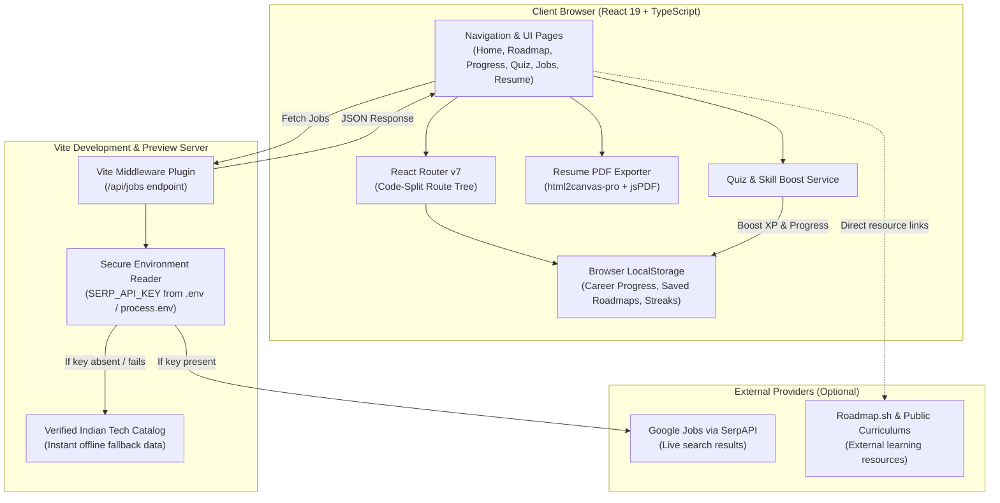
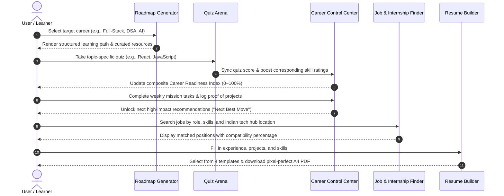

# 🧭 PathFinder — AI Career Guidance & Readiness Platform

<div align="center">


**An all-in-one autonomous career intelligence platform: personalized learning roadmaps, interactive skill tracking, timed technical quizzes, resume engineering with PDF export, and intelligent job matching.**

[](https://react.dev/)
[](https://www.typescriptlang.org/)
[](https://vitejs.dev/)
[](https://tailwindcss.com/)
[](https://www.framer.com/motion/)
[](https://www.chartjs.org/)
[](#system-architecture)
[](#-contributing)

[Overview](#-overview) • [Key Features](#-key-features) • [System Architecture](#-system-architecture) • [Workflow](#-project-workflow) • [Tech Stack](#-technology-stack) • [Installation & Setup](#-installation--setup) • [API Documentation](#-api-documentation) • [Contributing](#-contributing)

</div>

---

## 📌 Overview

### The Problem
Aspiring software engineers, students, and transitioning developers face a severely fragmented career preparation ecosystem:
- **Disjointed Tools:** Learners bounce between separate websites for roadmaps, isolated coding practice, generic job boards, and disconnected resume templates.
- **Lack of Continuity:** Progress made in tutorials or quizzes rarely translates into a measurable benchmark of real-world job readiness.
- **Generic Job Boards:** Traditional platforms fail to match junior and fresher applicants with realistic regional tech opportunities, flooding candidates with irrelevant senior listings.
- **Privacy & Setup Overhead:** Many platforms require mandatory cloud authentication, data collection, and complex database setup just to plan a learning path.

### The PathFinder Solution
**PathFinder** bridges this gap by unifying the entire career journey into a **privacy-first, local-first web application**. It binds curriculum discovery, active self-testing, weekly accountability missions, verified job listings, and resume generation into a single synchronized **Career Readiness Index**.

```
                        ┌──────────────────────────────────────────┐
                        │          PATHFINDER ECOSYSTEM            │
                        └────────────────────┬─────────────────────┘
                                             │
      ┌──────────────────┬───────────────────┼───────────────────┬──────────────────┐
      ▼                  ▼                   ▼                   ▼                  ▼
  CURRICULUM          PROGRESS             QUIZ                JOBS               RESUME
  ROADMAPS             CENTER             ARENA               FINDER             BUILDER
18+ Engineering    Weighted Readiness   Gamified Timed      Geo-Clustered      4 Templates &
   Disciplines     & Weekly Missions     Assessments       Indian Tech Hubs     jsPDF Export
```

---

## ✨ Key Features

### 🛤️ 1. Interactive Career Roadmap Engine
- **18+ Specialization Pathways:** Pre-configured and keyword-detected curriculums for:
  - *Core & Fundamentals:* Data Structures & Algorithms (DSA), System Design
  - *Web Engineering:* Frontend, Backend, Full-Stack, React, JavaScript
  - *Systems & Languages:* Python, C++, Java
  - *Cloud & Infrastructure:* DevOps, Docker, Kubernetes
  - *Next-Gen Tech:* Artificial Intelligence & Machine Learning, AI Engineer, Cybersecurity, Mobile (Android & iOS)
- **Stage-by-Stage Breakdown:** Each track is broken down into Foundation (Beginner), Intermediate, Advanced, and Expert tiers with verified learning resources (Coursera, MDN, LeetCode, MIT OCW, ByteByteGo).
- **External Resource Explorer:** Deep integration with curated learning resources and curriculum references.

### 📈 2. Career Control Center ("My Progress")
- **Composite Readiness Score:** Calculates a live 0–100% Career Readiness Index based on weighted Core, Supporting, and Tool competencies.
- **Weekly Missions & Task Checklists:** Actionable milestones that directly impact career readiness scores upon completion.
- **Proof-of-Progress Ledger:** Log and verify completed projects, coding challenges, certifications, and milestones with instant timestamping.
- **Activity Streaks:** Tracks daily consistency and consecutive learning streaks.
- **"Next Best Move" Engine:** Analyzes current skill gaps and recommends the highest-impact immediate action (e.g., take a targeted quiz or complete a core project).

### 🧠 3. Gamified Technical Quiz Arena
- **Multi-Discipline Question Banks:** In-depth technical assessments covering **JavaScript, React, HTML5, CSS3, and Node.js**.
- **Three Challenge Tiers:** Beginner, Intermediate, and Advanced difficulty modes.
- **Real-Time Code Evaluation:** Syntax-highlighted code snippets within questions.
- **Instant Explanations:** Deep conceptual explanations provided after every question.
- **Direct Skill Boost Synchronization:** Quiz scores feed back directly into the Career Control Center to level up relevant skills.

### 💼 4. Intelligent Job & Internship Discovery
- **Dual-Mode Data Pipeline:**
  - *Live Google Jobs Feed:* Integrates seamlessly with SerpAPI via an internal Vite server proxy.
  - *Verified Catalog Fallback:* Includes an extensive offline catalog of real Indian tech startups, quick-commerce giants, and MNCs (Zepto, Swiggy, Flipkart, CRED, Razorpay, etc.).
- **Indian Tech Hub Geo-Clustering:** Proximity search covering Mumbai, Pune, Bangalore, Delhi NCR, Hyderabad, and Chennai.
- **Fresher-Friendly Filter:** Automatically flags entry-level and internship-friendly opportunities.
- **Smart Skill Matching:** Computes an exact match percentage between user skills and job requirements.
- **Deep Application Links:** Direct URLs to application portals on Naukri, LinkedIn, Indeed, Internshala, and official career pages.

### 📄 5. Multi-Template Resume Builder & PDF Exporter
- **4 Designer Resume Templates:**
  - **Modern:** Contemporary header with clean skill badges and balanced typography.
  - **Minimal:** Streamlined, content-first layout suited for ATS screening.
  - **Professional:** Classic serif-accented structure tailored for corporate applications.
  - **Creative:** Vibrant layout with left sidebar and portfolio highlights.
- **Interactive Form Sections:** About, Education, Skills, and Experience with real-time validation.
- **High-Resolution PDF Compilation:** Client-side vector and canvas rendering via `html2canvas-pro` and `jspdf` for pixel-perfect A4 exports.

### 🤖 6. Embedded AI Career Assistant
- **Context-Aware Guidance:** On-demand assistance for career transitions, salary negotiation scripts, STAR method interview frameworks, and remote work strategies.
- **Rich Markdown Formatting:** Formatted checklists, action steps, and bulleted takeaways.
- **Text-to-Speech (TTS):** Speech synthesis hook (`useSpeechSynthesis`) for audible guidance.

---

## 📸 Screenshots & Visual Preview

> [!TIP]
> To display custom screenshots, place your images in the `images/` directory and update the markdown links below.

| Module | Preview | Description |
|---|---|---|
| **Home Page** | `images/preview-home.png`<br>*(Placeholder)* | Modern hero section with metrics, feature showcases, and interactive quick-start cards. |
| **Roadmap Generator** | `images/preview-roadmap.png`<br>*(Placeholder)* | Multi-tier curriculum generator with stage milestones and curated resource links. |
| **Progress Dashboard** | `images/preview-progress.png`<br>*(Placeholder)* | Career Readiness Index, weekly missions, skill breakdown, and proof-of-progress ledger. |
| **Technical Quiz** | `images/preview-quiz.png`<br>*(Placeholder)* | Interactive timed quiz interface featuring code blocks, score counters, and particle effects. |
| **Job Finder** | `images/preview-jobs.png`<br>*(Placeholder)* | Geo-clustered tech job search with skill compatibility tags and direct application links. |
| **Resume Builder** | `images/preview-resume.png`<br>*(Placeholder)* | Live-updating multi-template resume creator with instant one-click A4 PDF export. |

---

## 🛠️ Technology Stack

| Category | Technology | Version | Purpose in PathFinder |
|---|---|---|---|
| **Frontend Framework** | [React](https://react.dev/) | `^19.2.6` | Component architecture, lazy loading, and suspense boundaries |
| **Language** | [TypeScript](https://www.typescriptlang.org/) | `^6.0.3` | End-to-end static typing, interface contracts, and safety |
| **Build Tool & Server** | [Vite](https://vitejs.dev/) | `^8.0.13` | Next-gen dev server, lightning HMR, and production rollups |
| **CSS Framework** | [Tailwind CSS](https://tailwindcss.com/) | `^4.3.0` | Utility-first styling with `@tailwindcss/vite` integration |
| **Animations** | [Framer Motion](https://www.framer.com/motion/) | `^12.38.0` | Fluid page transitions, tab switches, and micro-interactions |
| **Routing** | [React Router](https://reactrouter.com/) | `^7.15.1` | Client-side routing, query parameter synchronization |
| **Icons** | [Lucide React](https://lucide.dev/) | `^1.16.0` | Consistent, lightweight vector iconography |
| **PDF Generation** | [jsPDF](https://github.com/parallax/jsPDF) & [html2canvas-pro](https://github.com/niklasvh/html2canvas) | `^4.2.1` / `^2.5.2` | High-fidelity client-side PDF document generation |
| **Charts & Metrics** | [Chart.js](https://www.chartjs.org/) & [react-chartjs-2](https://react-chartjs-2.js.org/) | `^4.5.1` / `^5.3.1` | Interactive data visualizations and skill distribution graphs |
| **Markdown Rendering** | [React Markdown](https://github.com/remarkjs/react-markdown) | `^10.1.0` | Safe rendering of AI guidance, tables, and formatted text |
| **Markdown Plugins** | `remark-gfm` & `rehype-raw` | `^4.0.1` / `^7.0.0` | GitHub-flavored markdown extensions and embedded HTML support |
| **Error Handling** | [react-error-boundary](https://github.com/bvaughn/react-error-boundary) | `^6.1.1` | Declarative UI error containment and graceful recovery |
| **Backend Middleware** | Node.js HTTP Middleware | Native Vite Plugin | Server-side `/api/jobs` proxy and secure SerpAPI integration |
| **Persistence** | Browser `localStorage` | HTML5 Standard | Zero-database, privacy-first local persistence |

---

## 🏛️ System Architecture

PathFinder uses a decoupled client-centric architecture. State is stored locally in the user's browser, while external network calls (such as job searches) are routed through a lightweight Node.js middleware within Vite to protect API secrets.



---

## 🔄 Project Workflow



---

## 📂 Project Structure

```text
Pathfinder/
├── images/                         # Project image assets & company brand logos
│   ├── company1.svg ... company10.svg
├── src/
│   ├── chatbot/                    # Embedded AI Career Chatbot module
│   │   ├── components/             # Markdown renderer, toggles, tooltips
│   │   ├── hooks/                  # useLocalStorage, useSpeechSynthesis
│   │   ├── utils/                  # Deterministic offline knowledge base & responses
│   │   └── ChatBot.tsx             # Floating chat assistant component
│   ├── components/
│   │   ├── home/                   # HeroSection, FeatureSection, StatsSection, CTA
│   │   ├── layout/                 # Navbar with mobile menu, Footer
│   │   ├── roadmap/                # RoadmapReadyCard, TransitionModal
│   │   └── shared/                 # Button, EnhancedLoadingSpinner, ErrorFallback
│   ├── data/
│   │   └── roadmapMappings.ts      # 18+ comprehensive tech tracks & keyword matching
│   ├── pages/
│   │   ├── Home.tsx                # Landing page & feature showcase
│   │   ├── JobFinder.tsx           # Geo-clustered job & internship search engine
│   │   ├── Progress.tsx            # Career Control Center ("My Progress")
│   │   ├── Quiz.tsx                # Gamified timed assessment arena
│   │   ├── Resume.tsx              # Multi-template resume builder orchestrator
│   │   ├── Roadmap.tsx             # Dynamic learning curriculum generator
│   │   └── RoadmapViewer.tsx       # Embedded/external roadmap inspection page
│   ├── resume/
│   │   ├── components/             # Form sections (About, Education, Skills, Experience)
│   │   ├── templates/              # Modern, Minimal, Professional, Creative templates
│   │   ├── constants.ts            # Default resume data, validation limits
│   │   ├── pdfExport.ts            # Client-side html2canvas + jsPDF engine
│   │   └── types.ts                # TypeScript types for resume state
│   ├── services/
│   │   ├── careerProgressService.ts# Readiness index, weekly missions, streaks, proofs
│   │   ├── jobService.ts           # Location clustering, match percentage algorithm
│   │   ├── quizService.ts          # Question banks across JS, React, HTML, CSS, Node
│   │   └── serpBackendHandler.ts   # Server-side /api/jobs proxy & verified catalog
│   ├── types/
│   │   └── index.ts                # Global TypeScript definitions
│   ├── App.tsx                     # Top-level routing, Suspense, Error Boundary
│   ├── index.css                   # Global Tailwind CSS imports & custom styles
│   └── main.tsx                    # React 19 root bootstrap
├── .env.example                    # Sample environment configuration
├── eslint.config.js                # ESLint flat configuration
├── index.html                      # HTML5 entry template with SEO metadata
├── package.json                    # Project metadata, dependencies & scripts
├── tsconfig.json                   # TypeScript compiler options
└── vite.config.ts                  # Vite config & jobsApiPlugin middleware
```

---

## ⚡ Installation & Setup

### Prerequisites
Make sure you have the following installed on your machine:
- **[Node.js](https://nodejs.org/)** (v18.0.0 or higher recommended; tested on v24)
- **[npm](https://www.npmjs.com/)** (v9.0.0 or higher) or compatible package manager

### 1. Clone the Repository
```bash
git clone https://github.com/your-username/pathfinder.git
cd pathfinder/Pathfinder
```

### 2. Install Dependencies
```bash
npm install
```

### 3. Environment Configuration *(Optional)*
The platform is designed to run **completely out-of-the-box with zero mandatory configuration**. If you do not provide any API keys, the application uses its built-in verified job catalog and offline intelligence.

To enable live Google Jobs search queries via SerpAPI, create a `.env` file:
```bash
cp .env.example .env
```
Edit `.env` and configure your API key:
```env
# Optional: Enables live Google Jobs search
SERP_API_KEY=your_serpapi_key_here
```

### 4. Run the Development Server
```bash
npm run dev
```
Open your browser and navigate to:
```
http://localhost:5173/
```

### 5. Build for Production
To create an optimized, minified production build:
```bash
npm run build
```

To preview the production build locally:
```bash
npm run preview
```

---

## 🔐 Environment Variables

| Variable | Required? | Default | Description |
|---|---|---|---|
| `SERP_API_KEY` | **Optional** | None *(uses verified catalog)* | API key from [SerpAPI](https://serpapi.com/) for live Google Jobs scraping. Read exclusively on the server side via Vite middleware. |

> [!NOTE]
> **No Database Credentials Required:** PathFinder does not require a database connection string or third-party authentication client IDs. All user progress, bookmarks, and resumes are saved privately in your browser's local storage.

---

## 📖 User Guide

<details>
<summary><b>1. Exploring Career Roadmaps</b></summary>

1. Navigate to the **Roadmap Generation** tab (`/roadmap`).
2. Choose from curated profession templates (e.g., Software Developer, Data Scientist, Designer) or type your custom goal.
3. Select specific focus areas (Frontend, Backend, DevOps, etc.).
4. Click **Generate Roadmap** to view structured stages with curated courses, documentation, and research papers.
5. Click **View Interactive Roadmap** to explore deep curriculum visualizers.
</details>

<details>
<summary><b>2. Tracking Career Readiness ("My Progress")</b></summary>

1. Navigate to **My Progress** (`/progress`).
2. Inspect your current **Career Readiness Index** percentage and status tier.
3. Switch between career tracks (e.g., Frontend, Backend, Full-Stack, AI Specialist).
4. Check off **Weekly Mission** tasks to increase readiness points.
5. Log verifiable milestones (hackathon projects, certificates, GitHub repos) in the **Proof of Progress** ledger.
6. Check your **Next Best Move** card for the highest-leverage immediate action.
</details>

<details>
<summary><b>3. Testing Knowledge in the Quiz Arena</b></summary>

1. Navigate to the **Quiz** section (`/quiz`).
2. Choose a topic: **JavaScript, React, HTML, CSS, or Node.js**.
3. Select a difficulty: **Beginner, Intermediate, or Advanced**.
4. Answer the 5 timed questions with real-time feedback and explanation cards.
5. Review your score breakdown and automatically receive skill boosts in the Career Control Center.
</details>

<details>
<summary><b>4. Searching Jobs & Internships</b></summary>

1. Navigate to **Find Jobs** (`/jobs`).
2. Enter your desired job title and select your skills.
3. Choose your preferred work arrangement (**Remote**, **Hybrid**, or **On-site**) and Indian hub (e.g., Bangalore, Pune, Mumbai, Delhi NCR).
4. Review calculated **Match Percentages**, fresher-friendly tags, and salary estimates.
5. Click **Apply on Platform** to open direct application URLs on Naukri, LinkedIn, Internshala, or company career portals.
</details>

<details>
<summary><b>5. Generating a Professional Resume</b></summary>

1. Navigate to **Build Your Resume** (`/resume`).
2. Complete the tabbed fields:
   - **About:** Contact details, headline, and bio.
   - **Education:** Degree, institution, graduation year, and highlights.
   - **Skills:** Categorized technical and soft proficiencies.
   - **Experience:** Internships, full-time positions, key achievements.
3. Use the **Template Switcher** in the preview panel to toggle between Modern, Minimal, Professional, and Creative layouts.
4. Click **Download PDF** to export a clean, print-ready A4 PDF document.
</details>

---

## 🔌 API Documentation

PathFinder includes an internal server-side proxy route handled by Vite middleware (`src/services/serpBackendHandler.ts`) to query job opportunities without exposing credentials to the client.

### `GET /api/jobs`

Fetches job and internship listings matching specified search criteria.

#### Request Query Parameters

| Parameter | Type | Required | Description |
|---|---|---|---|
| `role` | `string` | No | Target job title or keywords (e.g., `Frontend Developer`, `React`) |
| `location` | `string` | No | Target city or region (e.g., `Bangalore`, `Mumbai`, `Remote`) |
| `skills` | `string` | No | Comma-separated list of candidate skills (e.g., `React,TypeScript,Tailwind`) |
| `experience` | `string` | No | Experience filter (e.g., `Fresher`, `0–1 Years`, `1–3 Years`) |
| `workType` | `string` | No | Employment type (`Full-time`, `Internship`, `Part-time`, `Contract`) |
| `indiaOnly` | `boolean` | No | Set to `true` to restrict results exclusively to Indian locations |

#### Example Request
```http
GET /api/jobs?role=Frontend+Developer&location=Bangalore&skills=React,TypeScript&indiaOnly=true HTTP/1.1
Host: localhost:5173
```

#### Example Response Payload
```json
{
  "success": true,
  "source": "verified_catalog",
  "total": 12,
  "jobs": [
    {
      "id": "job-in-bangalore-1",
      "title": "Frontend Engineer - Design Systems",
      "company": "Swiggy",
      "location": "Bangalore, Karnataka",
      "workType": "Full-time",
      "isRemote": false,
      "salary": "₹12–18 LPA",
      "postedAt": "1 day ago",
      "description": "Build world-class food & grocery delivery interfaces using React, TypeScript, and Tailwind.",
      "skills": ["React", "TypeScript", "Tailwind CSS"],
      "applyUrl": "https://www.naukri.com/job-listings-swiggy-frontend-engineer-bangalore",
      "applySource": "Naukri",
      "isExactUrl": true,
      "isIndiaBased": true
    }
  ]
}
```

---

## 🔒 Security & Privacy

- **Local-First Architecture:** User profile data, resume entries, quiz histories, and progress tracking are stored strictly in the client's browser (`localStorage`). No personal information is transmitted to unauthorized remote databases.
- **Server-Side Credential Isolation:** Sensitive API tokens (such as `SERP_API_KEY`) are accessed strictly inside the Node.js development middleware and are never bundled into client-side JavaScript.
- **Input Sanitization:** User inputs in the resume builder and chat utilities pass through sanitization helpers to prevent Cross-Site Scripting (XSS) and malformed payload injection.
- **Error Resilience:** Top-level and section-specific React Error Boundaries (`react-error-boundary`) catch runtime exceptions without crashing the user interface.

---

## 🚀 Future Enhancements

The following features represent planned enhancements for future development cycles:

- [ ] **ATS Resume Score Analyzer:** Automated keyword matching between user resumes and target job descriptions.
- [ ] **Peer Comparison & Benchmarks:** Optional anonymized skill benchmarks against industry averages.
- [ ] **WebRTC Mock Technical Interviews:** Peer-to-peer or AI-assisted voice interview simulations.
- [ ] **Custom Quiz Creator:** Ability for mentors and educators to import custom question sets via JSON or CSV.
- [ ] **Cloud Sync (Optional):** Optional opt-in encrypted synchronization across devices.

---

## 🤝 Contributing

Contributions are what make the open-source community an amazing place to learn, inspire, and create. Any contributions you make are **greatly appreciated**.

### Contribution Workflow

1. **Fork the Repository**
2. **Create your Feature Branch**
   ```bash
   git checkout -b feature/AmazingFeature
   ```
3. **Commit your Changes**
   ```bash
   git commit -m 'feat: add amazing new feature'
   ```
4. **Push to the Branch**
   ```bash
   git push origin feature/AmazingFeature
   ```
5. **Open a Pull Request**

### Code Standards
- Adhere to the existing TypeScript conventions and strict null checks.
- Verify styling compatibility with Tailwind CSS v4.
- Run `npm run build` locally to verify that there are no TypeScript compilation or bundling errors before submitting your PR.

---

## 📄 License

This project is currently maintained by the repository owner. Please consult the author or check repository settings for specific open-source licensing terms before commercial redistribution.

---

## 👤 Authors & Acknowledgements

### 👤 Authors
- **[Sakshi Vishwakarma](https://www.linkedin.com/in/sakshi-vishwakarma-28296a37b/)**
- **[Ronak Agrawal](https://www.linkedin.com/in/ronak-agrawal-a158023a5/)**

### 🌟 Inspirations & Resources
- [Roadmap.sh](https://roadmap.sh/) for community curriculum frameworks.
- [Lucide Icons](https://lucide.dev/) for crisp UI icons.
- [SerpAPI](https://serpapi.com/) for Google Jobs structured data capabilities.

<div align="center">

**Built with passion to empower the next generation of engineers.**

⭐ Star this repository if PathFinder helped your career journey!

</div>
